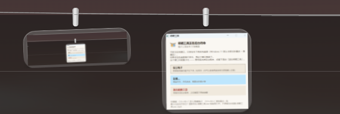
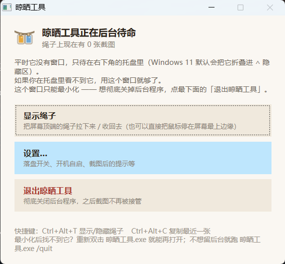

# Snapline · 晾晒工具

> Stop screenshots piling up on your desktop.
> 截图不再堆在桌面上 —— 挂到屏幕顶端的晾衣绳上。

[](https://github.com/yi-yezhiqiu/snapline/releases/latest)
[](LICENSE)

### [⬇ 下载 Snapline.exe](https://github.com/yi-yezhiqiu/snapline/releases/latest)

单文件 **103 KB**，**零依赖** —— 不需要装 .NET、Python 或任何运行环境，双击即用。
A single 103 KB file with zero dependencies. Just double-click it.

[中文](#中文) · [English](#english)



*截图不再落到桌面，而是挂在屏幕顶端的绳子上。鼠标移上去绳子滑出来，点一下就把图复制回剪贴板。*

---

## 中文

按你平时的习惯截图（微信 `Alt+A`、`PrtScn`、`Win+Shift+S` 都行），图**不会落到桌面**，
而是像晾衣服一样**挂到屏幕顶端的绳子上**。鼠标停到屏幕最上边缘，绳子滑下来；
点一下就把图复制回剪贴板，照常 `Ctrl+V` 粘到聊天框。鼠标移开，绳子自动收回，屏幕上什么都不剩。

### 特点

- **零依赖**：一个 103 KB 的 `.exe`，不需要装 .NET、Python 或任何运行环境
- **不改你的习惯**：`Alt+A` 那套照用，只要能进剪贴板就能被接住
- **完全离线**：不联网、无账号、无遥测
- **点击穿透**：绳子以外的地方鼠标照常操作下层窗口，只有照片可点
- **界面只有一根线**：没有背景板、没有标题栏，不挡你看东西

### 常用操作

| 你想做的事 | 怎么做 |
|---|---|
| 看绳子上的图 | 鼠标移到**屏幕最上边缘**停约 0.25 秒 |
| 把图粘到聊天框 | 照片上**点一下** → 去聊天框 `Ctrl+V` |
| 看大图 | **双击**照片 |
| 拖到微信 / Word | 按住照片**往外拖** |
| 另存为文件 | 照片上**点右键** |
| 丢掉一张 | 鼠标移上去，**左上角**出现 ✕，点它 |
| 显示 / 隐藏绳子 | `Ctrl + Alt + T` |
| 复制最近一张 | `Ctrl + Alt + C` |

### 运行与退出

双击 `晾晒工具.exe` 会弹出控制窗口：



| 按钮 | 作用 |
|---|---|
| 显示绳子 / 隐藏绳子 | 切换绳子展开状态 |
| 设置… | 落盘开关、开机自启、截图后的提示 |
| **退出晾晒工具** | 彻底关闭后台程序 |

这个窗口的标题栏**只有最小化，没有 ✕** —— 这是刻意的。窗口一关程序还在后台跑，
而托盘图标在 Windows 11 上默认被折叠进 `∧` 隐藏区，用户就再没有入口了。
所以退出只能走「退出晾晒工具」按钮，或命令行 `晾晒工具.exe /quit`。

最小化后想再打开：**重新双击 `晾晒工具.exe`** 即可恢复。

### 设置项

- **历史保留**：默认只放内存，程序一关就清空。打开「保存到磁盘」后截图会存成 PNG，
  重启后绳子上的图还在（默认目录 `图片\晾晒工具`）。
- **绳子容量**：超出上限自动丢掉最旧的。绳子上**同时显示**的数量另有上限，按屏幕宽度算（最多 12 张）。
- **截图后的反馈**：截完自动滑下来看一眼，默认停留 2500 毫秒；不想要可以关掉。
- **全屏应用时自动隐藏**：玩游戏、看视频、做演示时绳子不冒出来。
- **开机自动启动**：写 `HKCU\...\Run`，不需要管理员权限。

### 命令行参数

| 参数 | 作用 |
|---|---|
| `/quit` | 让正在运行的实例退出 |
| `/help` | 弹出说明：程序在哪、怎么退出 |
| `/quiet` | 配合 `/quit`，不弹确认框 |
| `/selftest` | DIB 解码自检（排查图片显示问题） |
| `/icontest` | 托盘图标自检（把图标 dump 成 PNG） |
| `/diag` | 诊断模式：注入测试图、打印窗口自检信息 |

### 自己编译

只需要 Windows 自带的编译器，**不需要 Visual Studio，也不需要 .NET SDK**：

```powershell
powershell -ExecutionPolicy Bypass -File build.ps1
```

编译产物在 `dist\晾晒工具.exe`。

### 实现要点

- **截图捕获**：`AddClipboardFormatListener` 监听剪贴板，按四级顺序取图 ——
  剪贴板直接给的 `PNG` → 自己解析 `DeviceIndependentBitmap` → 系统 `Clipboard.GetImage()` → WPF。
  32 位 DIB 一律按不透明处理（微信和部分截图工具的 alpha 通道常常全是 0，
  当预乘 alpha 解释就会得到一张纯黑图）。另加两道校验：解出来整张变黑但源数据不是全黑就换下一种途径；
  结果几乎全透明就强制转不透明。
- **剪贴板读取放在 STA 的 UI 线程**：OLE 调用不能在 MTA 线程做。
- **顶端窗口**：无边框 + `WS_EX_TOOLWINDOW|WS_EX_NOACTIVATE`（不进 Alt+Tab、不抢焦点），
  通过直接滑动窗口 `Top` 实现滑出/收回（`Window.Top` 用 `BeginAnimation` 动画并不可靠）。
- **全屏检测**：比对前台窗口矩形与显示器矩形。
- **所有图形都是代码画的**：绳、金属夹、玻璃边框、托盘图标（自写标准 ICO）。

### 与 macOS 原版的差异

本项目参考 [Tendedero](https://github.com/alejandrobujan/tendedero) 的概念，用 C# / WPF 从零重写，
**不共享任何源码**；原作的名称与图标不在其 MIT 授权范围内，所以这里用自绘图标和自己的名字。

几处**必须**不同：

| 项目 | 说明 |
|---|---|
| 没有标注功能 | 原版长按调起 macOS 的 Markup 标注器，Windows 没有对应组件。建议用微信截图自带的编辑。 |
| 分不清剪贴板图片的来源 | Windows 硬限制。从网页/Word 复制的图也会上绳，误收的点 ✕ 丢掉。 |
| 取图会覆盖剪贴板 | 「点一下就粘」的必然代价。 |
| 没有跨全屏的飞入 / 坠落动画 | 原版用 CALayer 在整个屏幕上画动画；本版保留了落点动画（上方落下 + 摆动）。 |
| 玻璃材质是近似的 | 原版用 macOS 的 `ultraThinMaterial`（真实背景模糊），WPF 无等价物，用半透明亮面近似。 |

### 已知限制

`Ctrl+Alt+T` / `Ctrl+Alt+C` 通过系统 `RegisterHotKey` 注册，注册返回成功，
但**在自动化沙箱里无法验证按键效果**（沙箱会拦截合成按键注入）。
如果你的机器上按了没反应，多半是这个组合被别的软件占用了 ——
鼠标碰屏幕上边缘和托盘/控制窗口不受影响。

### 项目结构

```
├── build.ps1              ← 一键编译脚本
├── publish.py             ← 发 Release（Python，绕开 .NET 的 TLS 限制）
├── src/                   ← 全部源码（19 个 .cs，中文注释）
├── tools/smoke-test/      ← 自动化验证探针（抓屏 / 点击 / 关窗 / 顶端呼出 / DIB 解码）
├── docs-line.png          ← 绳子挂在屏幕顶端的实际效果
├── docs-control-window.png
├── 使用说明.md             ← 更详细的中文说明
└── LICENSE
```

---

## English

Take a screenshot the way you always do (WeChat `Alt+A`, `PrtScn`, `Win+Shift+S` — anything
that lands an image on the clipboard). It never touches your desktop. Instead it hangs on a
clothesline along the top edge of the screen. Move the pointer to the top edge and the line
slides down. Click a photo to put it back on your clipboard, then paste as usual. Move away
and the line tucks itself out of sight.

### Highlights

- **Zero dependencies.** One 103 KB `.exe`. No .NET install, no Python, no runtime.
- **Your shortcut, unchanged.** Anything that reaches the clipboard gets picked up.
- **Offline by design.** No account, no network, no telemetry.
- **Clicks pass through.** Only the photos are interactive; everything else goes to whatever is underneath.
- **Just a line.** No panel, no title bar, nothing covering your work.

### Everyday use

| I want to… | Do this |
|---|---|
| See the line | Rest the pointer at the very top edge for ~0.25 s |
| Paste a photo | **Click** it, then `Ctrl+V` |
| View it large | **Double-click** the photo |
| Drag into WeChat / Word | **Drag** the photo out |
| Save as a file | **Right-click** the photo |
| Discard one | Hover it, click the **✕** in the top-left corner |
| Show / hide the line | `Ctrl + Alt + T` |
| Copy the newest one | `Ctrl + Alt + C` |

### Running and quitting

Double-click `晾晒工具.exe`. A control window appears with three buttons: toggle the line,
open settings, and **quit the app**.

Its title bar has **minimize but no ✕**, deliberately. Closing that window would leave the app
running in the background with no way back in — on Windows 11 the tray icon is hidden in the
`∧` overflow by default. So quitting goes through the button, or `晾晒工具.exe /quit`.
After minimizing, just double-click the exe again to bring the window back.

### Building

Only needs the C# compiler that ships with Windows. **No Visual Studio, no .NET SDK.**

```powershell
powershell -ExecutionPolicy Bypass -File build.ps1
```

Output lands in `dist\晾晒工具.exe`.

### How it works

- **Capture**: `AddClipboardFormatListener`, then a four-tier read — the `PNG` format if the
  clipboard offers it, otherwise a hand-written `DeviceIndependentBitmap` decoder, then the
  system's `Clipboard.GetImage()`, then WPF. 32-bit DIBs are always treated as opaque, because
  WeChat and several capture tools leave the alpha channel at zero and interpreting that as
  premultiplied alpha yields a solid black frame. Two extra guards: if decoding produces an
  all-black image while the source is not black, try the next tier; if the result is almost
  entirely transparent, force it opaque.
- **Clipboard access runs on the STA UI thread** — OLE calls are not valid on MTA threads.
- **The line window** is borderless with `WS_EX_TOOLWINDOW|WS_EX_NOACTIVATE` (no Alt+Tab entry,
  never steals focus) and slides by moving the window's `Top` directly, since animating
  `Window.Top` with `BeginAnimation` is unreliable.
- **Full-screen detection** compares the foreground window rect against the monitor rect.
- **Every graphic is drawn in code**: the rope, the aluminium clothespin, the glass frame, and
  the tray icon (a hand-written ICO with BMP frames and an AND mask).

### Differences from the macOS original

A from-scratch C# / WPF reimplementation of the idea in
[Tendedero](https://github.com/alejandrobujan/tendedero). It shares no source code; the
original's name and icon are not covered by its MIT license, so this port ships its own.

| Item | Why it differs |
|---|---|
| No markup/annotation | The original opens macOS Markup on long press; Windows has no equivalent system component. Use WeChat's built-in editor. |
| Clipboard image sources can't be told apart | A Windows limitation. Images copied from a browser or Word also land on the line — discard them with the ✕. |
| Clicking a photo overwrites your clipboard | The unavoidable cost of "click once to paste". |
| No full-screen fly-in / fall animation | The original draws those with CALayer across the whole screen; this port keeps the landing animation (drop + swing). |
| The glass frame is an approximation | The original uses macOS `ultraThinMaterial`; WPF has no equivalent, so it's a translucent highlight. |

### License

MIT. See [LICENSE](LICENSE).
